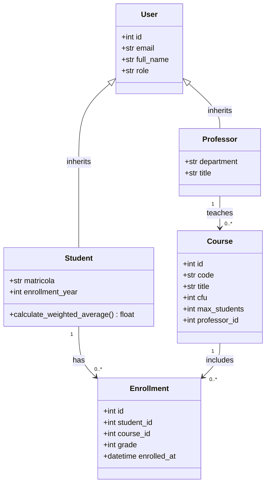
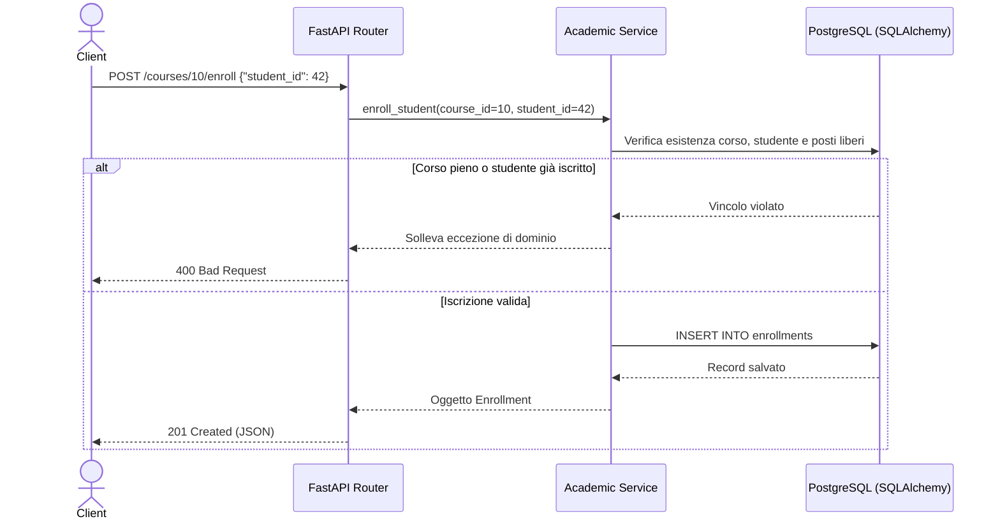

# UniManager API

Backend RESTful ad alte prestazioni per la gestione dell'anagrafica accademica, dei corsi, delle iscrizioni e della verbalizzazione dei voti universitari.

## Architettura del Sistema

Il progetto segue una **Layered Architecture** (Architettura a Livelli) per garantire la netta separazione delle responsabilità:

* **API Layer (`app/api`):** Espone gli endpoint REST, gestisce le richieste/risposte HTTP e delega la validazione a Pydantic.
* **Service Layer (`app/services`):** Contiene la *Business Logic* pura (controllo posti disponibili, validazione range voti, calcolo media ponderata e CFU), completamente disaccoppiata dal framework web.
* **Data Layer (`app/models`):** Definisce i modelli ORM tramite SQLAlchemy mappati su PostgreSQL.

### Stack Tecnologico
* **Linguaggio:** Python 3.12+
* **Framework Web:** FastAPI + Uvicorn
* **Validazione Dati:** Pydantic v2
* **Database & ORM:** PostgreSQL 16 + SQLAlchemy 2.0
* **Testing:** Pytest + HTTPX
* **Infrastruttura & CI/CD:** Docker, Docker Compose, GitHub Actions

---

## Modello dei Dati (UML Class Diagram)

L'ereditarietà tra `User`, `Student` e `Professor` è implementata tramite **Joined Table Inheritance** per mantenere il database normalizzato ed evitare campi `NULL` superflui.

---

## Flusso di Esecuzione (Sequence Diagram)

Esempio del flusso completo di una richiesta di iscrizione a un corso (`POST /courses/{id}/enroll`):

---

## Contratti delle API Principali

| Metodo | Endpoint | Descrizione | Codici di Risposta |
| :--- | :--- | :--- | :--- |
| `POST` | `/students` | Registra un nuovo studente | `201 Created`, `409 Conflict` |
| `POST` | `/professors` | Registra un nuovo docente | `201 Created`, `409 Conflict` |
| `POST` | `/courses` | Crea un nuovo corso universitario | `201 Created`, `404 Not Found` |
| `POST` | `/courses/{id}/enroll` | Iscrive uno studente a un corso | `201 Created`, `400 Bad Request`, `404 Not Found` |
| `PATCH` | `/enrollments/{id}/grade` | Verbalizza il voto (18-31, dove 31 = 30L) | `200 OK`, `400 Bad Request`, `404 Not Found` |
| `GET` | `/students/{id}/transcript` | Restituisce libretto, CFU e media ponderata | `200 OK`, `404 Not Found` |